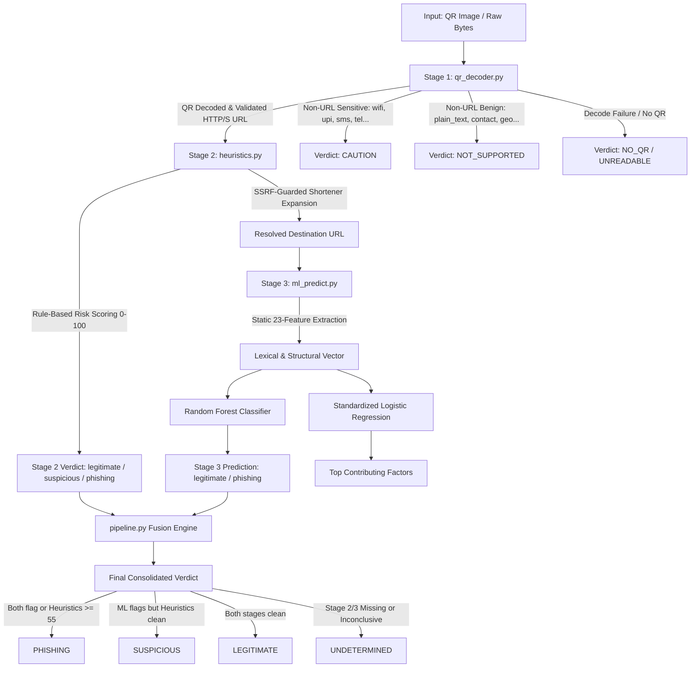

# Quishing Shield: Multi-Stage QR Phishing Detection Framework

A defense-in-depth cybersecurity framework developed for detecting and analyzing **Quishing (QR Code Phishing)** attacks. The system combines local computer-vision QR decoding, deterministic security heuristics with safe shortener resolution, and static machine learning classification to evaluate QR payloads without exposing users or systems to exploit delivery.

---

## 1. Problem Statement: The Quishing Threat

QR codes encode arbitrary text, most commonly web addresses (URLs). In a **Quishing** attack, an adversary embeds a malicious or deceptive URL inside a QR code placed on physical media (parking meters, posters, dining tables, payment stickers) or digital media (phishing emails, PDF invoices).

Traditional security controls face critical vulnerabilities against Quishing:
1. **Perceptual Blindness:** Humans cannot visually parse the payload encoded in a QR matrix before scanning.
2. **Email Gateway Bypass:** QR codes embedded in email bodies or PDF attachments bypass standard email gateway lexical filters and domain reputation scanners.
3. **Drive-by & Exploitation Hazards:** Simply scanning a QR code and loading the destination in a browser exposes the endpoint to drive-by exploit kits, browser zero-days, cloaked phishing kits, and unauthenticated network transactions.

**Quishing Shield** mitigates these risks by isolating the decoding and classification layers:
* Decodes the QR image **completely offline**.
* Analyzes payload risk **statically** using lexical heuristics and machine learning.
* Safely inspects URL shorteners **without ever contacting or downloading content from the final destination**.

---

## 2. Architecture & Pipeline Workflow

The framework operates as a 3-stage modular pipeline orchestrated by `pipeline.py`:



---

## 3. Repository Structure

```
QR_Phishing/
├── README.md                      # Primary project documentation (this file)
├── pipeline.py                    # Production end-to-end orchestration pipeline
├── pipeline_teammate.py           # Teammate alternative pipeline implementation (contains known issues)
├── run_all_samples.py             # Batch evaluation runner for test images
├── evaluate_pipeline.py           # Evaluation runner across 32 synthetic test cases
├── app.py                         # Local standalone Flask web interface
├── live_demo.py                   # Interactive CLI demo runner (generates QR & analyzes)
├── requirements.txt               # Unified project dependencies referencing all stages + flask
├── eval_output.txt                # Cached console benchmark output from evaluate_pipeline.py
├── eval_results.csv               # Row-by-row prediction and metric export
├── eval_set/                      # 32 benchmark QR images and manifest.csv
│   └── manifest.csv
├── docs/
│   ├── WALKTHROUGH.md             # Detailed step-by-step pipeline walkthrough & worked example
│   └── ISSUES_FOUND.md            # Comprehensive audit of bugs, discrepancies & safety findings
├── stage1_qr_decoding/            # Member 1: Computer Vision & Payload Typing
│   ├── qr_decoder.py              # Dual OpenCV/pyzbar decoder, inversion & payload classifier
│   ├── demo_cli.py                # Standalone Stage 1 CLI demonstration
│   ├── generate_test_qr.py        # Generates 19 sample QR codes (URL and non-URL payloads)
│   ├── generate_varied_qr.py      # Generates 108 visual variants across 18 rendering styles
│   ├── test_decoder.py            # Unit tests for Stage 1 decoders & payload classification
│   ├── test_rendering_consistency.py # Tests decoding invariance across 108 variants
│   ├── test_pipeline.py           # Pipeline wiring unit tests using mock stages
│   ├── requirements.txt           # Stage 1 dependencies
│   ├── test_images/               # 19 standard test images
│   └── test_images_varied/        # 108 varied rendering test images
├── stage2_heuristics/             # Member 2: Heuristic Analysis & Shortener Resolution
│   ├── heuristics.py              # 12-rule heuristic engine & SSRF-safe shortener resolution
│   ├── demo_cli.py                # Standalone Stage 2 CLI demonstration
│   ├── test_heuristics.py         # 36 unit tests for heuristics, boundaries & SSRF safety
│   └── requirements.txt           # Stage 2 dependencies
└── stage3_ml/                     # Member 3: Machine Learning & Feature Explanation
    ├── feature_extractor.py       # 23 purely static lexical/structural URL features (0 network)
    ├── ml_predict.py              # Random Forest prediction & Logistic Regression explanations
    ├── train_model.py             # Grouped domain split, 5-fold CV, and ablation training script
    ├── get_dataset.py             # PhiUSIIL acquisition and clean CSV generator
    ├── demo_stage3.py             # Stage 3 demonstration across 31 curated sanity URLs
    ├── test_feature_extractor.py  # Unit tests for feature extractor and socket-blocking verification
    ├── test_render_consistency.py # Verifies ML invariance across QR visual rendering styles
    ├── evaluate_on_testset.py     # Stage 4 testset evaluation runner
    ├── benchmark_trad_chehab.py   # Optional benchmark for pixel-array datasets
    ├── feature_selection.md       # Rationale for 23 features and exclusion of DOM/DNS/WHOIS
    ├── requirements.txt           # Stage 3 dependencies (pinned scikit-learn==1.7.2)
    ├── data/
    │   ├── urls_labeled.csv       # Clean labeled dataset (regenerate via python stage3_ml/get_dataset.py)
    │   ├── sanity_urls.csv        # 31 curated test URLs
    │   ├── qr_testset_manifest.csv# Manifest with testset visual variations
    │   └── testset_images/        # Pre-generated QR testset images
    ├── models/
    │   └── phishing_model.joblib  # Serialized model bundle (RF, LR + scaler, metadata)
    └── reports/
        ├── metrics.json           # Quantitative model metrics export
        ├── confusion_matrix.png   # Comparative confusion matrices (LR vs RF)
        ├── roc_curve.png          # ROC curves (LR, RF, and No-HTTPS ablation)
        └── feature_importance.png # Top 15 Random Forest Gini feature importances
```

---

## 4. Setup & Installation (Windows, Python 3.10)

### 4.1 Prerequisites
* Python 3.10 installed on Windows.
* A Python virtual environment is strongly recommended:
  ```powershell
  python -m venv venv
  .\venv\Scripts\Activate.ps1
  ```

### 4.2 Installing Dependencies
Each stage maintains its own `requirements.txt`. Install all dependencies:
```powershell
# Stage 1: QR Decoding & Image Processing
pip install -r stage1_qr_decoding\requirements.txt

# Stage 2: Heuristics & Network Utilities
pip install -r stage2_heuristics\requirements.txt

# Stage 3: Machine Learning & Numerical Analysis
pip install -r stage3_ml\requirements.txt

# Web Interface & Demo Helpers
pip install flask qrcode
```

> **pyzbar vs. OpenCV Backend Note:**
> `pyzbar` depends on `libzbar-64.dll` which requires the *Microsoft Visual C++ 2013 Redistributable (x64)* on Windows. If the DLL is not present, [stage1_qr_decoding/qr_decoder.py](stage1_qr_decoding/qr_decoder.py#L47-L63) catches the `ImportError` gracefully and falls back to **OpenCV** (`cv2.QRCodeDetectorAruco` and `cv2.QRCodeDetector`). All tests and pipeline scripts operate with 100% functionality under the OpenCV fallback alone.

---

## 5. Execution Guide

### 5.1 Running the Full Pipeline
To analyze any QR image through all 3 stages:
```powershell
python pipeline.py stage1_qr_decoding\test_images\phishing_style_ip.png
```

### 5.2 Running Individual Stages
* **Stage 1 Standalone Demo:**
  ```powershell
  python stage1_qr_decoding\demo_cli.py stage1_qr_decoding\test_images\wifi_config.png
  ```
* **Stage 2 Standalone Demo:**
  ```powershell
  python stage2_heuristics\demo_cli.py "http://192.168.1.50/login/secure-update"
  ```
* **Stage 3 Standalone Demo:**
  ```powershell
  python stage3_ml\ml_predict.py "http://192.168.1.50/login/secure-update"
  python stage3_ml\demo_stage3.py
  ```

### 5.3 Batch Evaluation & Synthetic Benchmarks
* **Evaluate Standard Sample Set (19 QR codes):**
  ```powershell
  python run_all_samples.py
  ```
* **Evaluate Rendering Variants (108 QR codes):**
  ```powershell
  python run_all_samples.py --varied
  ```
* **Run 32-URL Synthetic Evaluation Suite:**
  ```powershell
  python evaluate_pipeline.py
  ```

### 5.4 Interactive Demonstrations & Web UI

**Interactive CLI Runner (`live_demo.py`):**

Run from the repository root:

```powershell
python live_demo.py
```

To analyze a URL:

```powershell
python live_demo.py http://192.168.1.50/login/secure-update
```

To analyze a QR image:

```powershell
python live_demo.py --image path\to\qr.png
```

**Local Web Interface (`app.py`):**

Install dependencies and start the Flask server:

```powershell
pip install -r requirements.txt
python app.py
```

Open http://127.0.0.1:5000 in your browser. The interface supports URL input and QR-image uploads for pipeline analysis. It is intended for local testing and does not require opening the analyzed URLs.

### 5.5 Dataset Acquisition & Model Retraining (Stage 3)
* **Regenerate Clean Labeled URL Dataset (`urls_labeled.csv`):**
  Downloads the PhiUSIIL Phishing URL Dataset (UCI ID 967) directly from the UCI Machine Learning Repository, strips all 54 content/DOM/DNS columns to guarantee 100% static URL classification, maps labels (`1` = Phishing target, `0` = Legitimate), removes duplicate/conflicting records, and writes `stage3_ml/data/urls_labeled.csv`:
  ```powershell
  python stage3_ml/get_dataset.py
  ```
* **Retrain Models & Generate Report Artifacts:**
  Extracts 23 static lexical/structural URL features, performs domain-grouped train/test splitting (`GroupShuffleSplit`, 0 domain leakage), tunes Random Forest hyperparameters (5-fold CV), trains the standardized Logistic Regression baseline, runs the No-HTTPS ablation study, and saves `stage3_ml/models/phishing_model.joblib`:
  ```powershell
  python stage3_ml/train_model.py
  ```

---

## 6. Pipeline Verdict Logic

The decision fusion in [pipeline.py](pipeline.py#L74-L140) combines verdicts across stages as follows:

| Stage 1 Status / Payload | Stage 2 Heuristics Verdict | Stage 3 ML Prediction | Final Pipeline Verdict | Primary Rationale |
|---|---|---|---|---|
| `not_a_url` (sensitive=True) | *Bypassed* | *Bypassed* | **`caution`** | Sensitive non-URL payload detected (WiFi, UPI, Crypto, SMS, Phone). |
| `not_a_url` (sensitive=False) | *Bypassed* | *Bypassed* | **`not_supported`** | Non-URL benign payload (plain text, vCard, calendar, geo). |
| `no_qr` | *Bypassed* | *Bypassed* | **`no_qr`** | No finder patterns or matrix detected in image. |
| `unreadable` | *Bypassed* | *Bypassed* | **`unreadable`** | Corrupt image data or unreadable file. |
| `ok` (valid URL) | `phishing` (score $\ge 55$) | `phishing` | **`phishing`** | Both heuristic and ML layers agree on attack indicators. |
| `ok` (valid URL) | `phishing` (score $\ge 55$) | `legitimate` | **`phishing`** | Heuristic rules triggered strong red flags (e.g., raw IP, `@` symbol). |
| `ok` (valid URL) | `phishing` (score $\ge 55$) | *Error / Missing* | **`phishing`** | Heuristic rules triggered strong red flags. |
| `ok` (valid URL) | `suspicious` (score 25–54) | `phishing` | **`suspicious`** | Heuristic red flags present, corroborated by ML. |
| `ok` (valid URL) | `legitimate` (score < 25) | `phishing` | **`suspicious`** | ML flags phishing, but heuristics found no strong structural red flags. |
| `ok` (valid URL) | *Error / Missing* | `phishing` | **`suspicious`** | ML flags phishing; heuristics unavailable. |
| `ok` (valid URL) | `suspicious` (score 25–54) | `legitimate` | **`legitimate`** | Low-level heuristic flags overridden by legitimate ML classification. |
| `ok` (valid URL) | `legitimate` (score < 25) | `legitimate` | **`legitimate`** | Both heuristic and ML models clear the URL. |
| `ok` (valid URL) | `legitimate` (score < 25) | *Error / Missing* | **`legitimate`** | Cleared by heuristics; ML unavailable. |
| `ok` (valid URL) | *Missing / Inconclusive* | *Missing / Inconclusive* | **`undetermined`** | Neither Stage 2 nor Stage 3 produced an actionable verdict. |

---

## 7. Measured Results & Empirical Performance

> [!NOTE]
> **Caveat on Benchmark Scale:**
> The 32-URL evaluation set in `eval_set/manifest.csv` consists of 16 real legitimate sites and 16 synthetic phishing links using reserved domains (`.example`) and RFC test IPs. These results are indicative of architecture performance and are not a substitute for large-scale external validation.

### 7.1 Stage 1 Visual Decoding Resilience ([test_rendering_consistency.py](stage1_qr_decoding/test_rendering_consistency.py))
Evaluated across 6 distinct URLs rendered in 18 variations (clean, hard, degraded):
* **Clean Renderings (Base, EC L/Q/H, Box Sizes, Versions):** 60 / 60 (100%)
* **Hard Renderings (Color inversion, Navy/Cream, Green/White, No border):** 12 / 12 (100%)
* **Degraded Renderings (JPEG Q30, Gaussian blur, 20° rotation, 120px scale, Low contrast):** 36 / 36 (100%)
* **Total Accuracy:** **108 / 108 (100%)**
* **Decoding Errors (Wrong URL Decoded):** **0**

### 7.2 Stage 3 Machine Learning Metrics ([stage3_ml/reports/metrics.json](stage3_ml/reports/metrics.json))
Evaluated on a held-out test split of **9,826 URLs** from the PhiUSIIL (UCI 967) dataset using **GroupShuffleSplit** by domain (guaranteeing zero domain overlap between training and testing):

| Classifier Model | Accuracy | Precision | Recall | F1-Score | ROC-AUC |
|---|:---:|:---:|:---:|:---:|:---:|
| **Logistic Regression (Baseline & Explanation)** | 92.17% | 95.24% | 85.40% | 0.9005 | 0.9612 |
| **Random Forest (Primary Classifier)** | **94.57%** | **97.53%** | **89.16%** | **0.9316** | **0.9787** |
| **Random Forest (No-HTTPS Ablation)** | 89.15% | 94.87% | 78.07% | 0.8565 | 0.9536 |

*Top Gini Feature Importances (Random Forest):*
1. `is_https`: 0.4384
2. `hostname_digits`: 0.0973
3. `digit_ratio`: 0.0816
4. `hostname_length`: 0.0600
5. `special_char_ratio`: 0.0544

### 7.3 End-to-End Pipeline Evaluation ([eval_output.txt](eval_output.txt), [eval_results.csv](eval_results.csv))
Evaluated across 32 QR codes (16 legitimate, 16 phishing):

| Evaluation Strategy | TP | FP | FN | TN | Accuracy | Precision | Recall | F1-Score |
|---|:---:|:---:|:---:|:---:|:---:|:---:|:---:|:---:|
| **Stage 2 Alone (`phishing` only)** | 7 | 0 | 9 | 16 | 0.72 | 1.00 | 0.44 | 0.61 |
| **Stage 2 Alone (`phishing` OR `suspicious`)** | 15 | 0 | 1 | 16 | 0.97 | 1.00 | 0.94 | 0.97 |
| **Stage 3 (ML) Alone** | 16 | 3 | 0 | 13 | 0.91 | 0.84 | 1.00 | 0.91 |
| **Hybrid Final (`phishing` only)** | 7 | 0 | 9 | 16 | 0.72 | 1.00 | 0.44 | 0.61 |
| **Hybrid Final (`phishing` OR `suspicious`)** | 16 | 3 | 0 | 13 | 0.91 | 0.84 | 1.00 | 0.91 |

*Key Findings from Benchmark:*
* **Zero Misses under Broad Flagging:** When `suspicious` is treated as a security flag, the hybrid pipeline caught **16 / 16 (100%)** of phishing links.
* **Conservative Hybrid Gatekeeper:** The primary hybrid pipeline classified 7 phishing links as `phishing` and 9 phishing links as `suspicious`, producing **0 false alarms on legitimate URLs** as `phishing`.
* **Legitimate Login Page Sensitivity:** Complex legitimate authentication URLs (`accounts.google.com/signin/v2/identifier`, `mail.google.com`) were classified as `suspicious` by ML due to deep query parameters, but cleared by Stage 2 heuristics.

---

## 8. Limitations & Scope Constraints

1. **Protocol Reliance (`is_https`):** The ablation study proves that removing `is_https` causes recall to drop from 89.16% to 78.07%. Free TLS certificates (Let's Encrypt) allow modern phishers to serve HTTPS, making transport encryption alone an imperfect differentiator.
2. **Shortener Dependency on Network Availability:** Expanding shortened URLs requires active network connectivity. If the scanner is entirely air-gapped or offline, shorteners cannot be expanded to reveal the destination.
3. **Typosquatting Detection:** Deterministic heuristics currently lack edit-distance checks against global brand registries; e.g., `http://paypa1.example/signin` scored only 20 in Stage 2 heuristics and relied entirely on Stage 3 ML for detection.
4. **Synthetic Testset Scope:** The 32-sample benchmark uses synthetic `.example` domains; real-world phishing in the wild exhibits evolving obfuscations not captured by small static sets.

---

## 9. Team Roles & Responsibilities

* **Member 1 (Stage 1 — QR Decoding & Payload Typing):** Implemented [stage1_qr_decoding/qr_decoder.py](stage1_qr_decoding/qr_decoder.py), image loading, dual OpenCV/pyzbar recovery, color inversion retries, payload typing, sensitive non-URL warnings, and pipeline orchestration ([pipeline.py](pipeline.py)).
* **Member 2 (Stage 2 — Heuristic Engine & Safe Shortener Resolution):** Implemented [stage2_heuristics/heuristics.py](stage2_heuristics/heuristics.py), 12 heuristic risk rules, SSRF-safe HTTP HEAD/GET resolution with loop/hop caps, and destination connection refusal.
* **Member 3 (Stage 3 — ML Classification & Explainability):** Implemented [stage3_ml/feature_extractor.py](stage3_ml/feature_extractor.py), 23 static URL features, [stage3_ml/train_model.py](stage3_ml/train_model.py), Random Forest and Logistic Regression model training with domain-grouped splits, and local linear factor attribution in [stage3_ml/ml_predict.py](stage3_ml/ml_predict.py).
